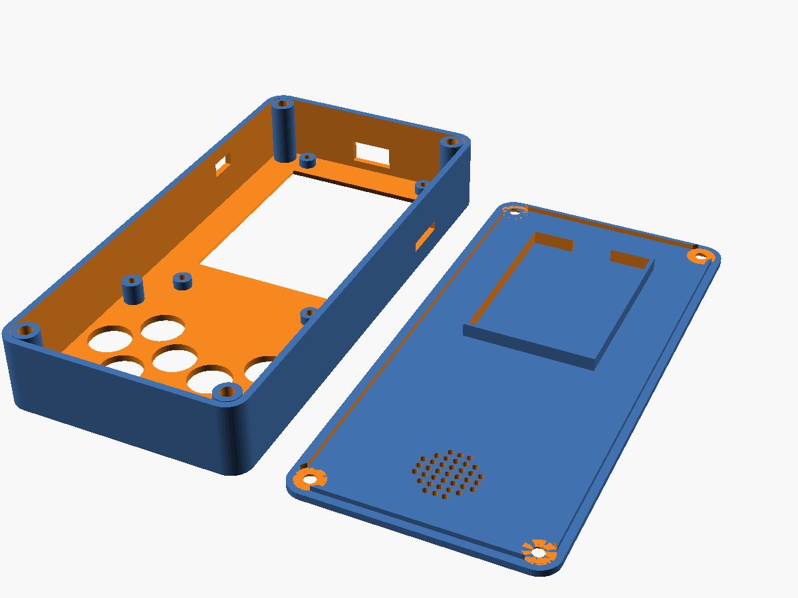

# Enclosure – 3D-printed case

A two-part case in the Brick Game style: a **shell** (front and walls) and a **lid** (back),
held together with 4 M3 screws.

Files:
- `enclosure/case.scad` – the parametric source (OpenSCAD). **Edit this file.**
- `enclosure/stl/shell.stl`, `lid.stl`, `test_front.stl` – ready to slice (draft v1)
- `enclosure/preview/assembly.png`, `inside.png` – rendered previews



## 1. Layout (front view, 72 × 150 × 24 mm)

```
          USB-C (top edge)
   ┌──────────╥──────────────┐
   │ ┌──────────────────────┐│
   │ │                      ││
   │ │   2.8" screen        ││  ← ES3N28P mounted upside down
   │ │   window 45 × 60 mm  ││    so its USB-C faces the top
   │ │                      ││
   │ │                      ││
   │ └──────────────────────┘│
 ▭ │      (PCF8574 area)     │ ▭ ← SD slot (right wall, verify)
 ↑ │                         │
 power│     ▲               A │
 switch  ◄     ►        B     │
   │     ▼                   │
   │         SEL  START      │
   └─────────────────────────┘
   Back (lid): battery pocket behind the screen, speaker grille behind the buttons
```

## 2. Cross-section (side view, front on the left)

```
 z: 0   2      4.8 6.4        11.1             ~16        22  24
    │███│ LCD  │PCB│ board parts│ (air/cables) │ battery  │███│
    │███│ 2.8  │1.6│   4.7      │              │ 6 mm     │███│
 front plate                                         lid 2 mm
```

| Stack item | Depth (z) |
|---|---|
| Front plate | 0 – 2 |
| LCD + glue (rests on the plate) | 2 – 4.8 |
| PCB (screwed onto 4 bosses) | 4.8 – 6.4 |
| Parts on the back of the board | to 11.1 |
| Battery 603450 (in the lid pocket) | 16 – 22 |
| Lid | 22 – 24 |
| Button perfboard front face | 8.5 (`btn_pcb_z`) |

## 3. Before printing – measure and adjust

The draft uses numbers from the datasheet drawing. Before the full print, **measure the real
parts** with calipers and change these parameters in `case.scad`:

| Parameter | What to measure |
|---|---|
| `usb_x` | Distance from the board's left edge to the USB-C centre (seen from the front, with the board rotated) |
| `sd_y`, `sd_enable` | Position of the microSD slot; check that it faces the board edge |
| `btn_pcb_z` | `h − 1.5`, where `h` = height from perfboard to the top of a 12 mm cap |
| `big_d`, `small_d` | Your cap diameter + 0.6 mm, stem diameter + 0.6 mm |
| `bat`, `bat_y` | Battery size + 1–2 mm |
| `sw_y`, `sw_z`, `sw_size` | Slide switch position and body size |
| `aa` | If the screen window looks off-centre after the test print |

You can also open `docs/es3n28p/ES3N28P_3D.step` in FreeCAD to check the USB and SD positions.

Export from the command line:
```sh
openscad -o enclosure/stl/shell.stl -D 'part="shell"' enclosure/case.scad
openscad -o enclosure/stl/lid.stl   -D 'part="lid"'   enclosure/case.scad
```

## 4. Printing

| Setting | Value |
|---|---|
| Material | PLA (easy) or PETG (tougher, better if it gets warm) |
| Layer height | 0.2 mm |
| Walls / top/bottom | 3 perimeters / 4 layers |
| Infill | 20 % gyroid |
| Orientation | **Shell: front face down. Lid: outside face down.** No supports needed. |
| Time / filament | ~5–6 h / ~70–80 g total |

**Do a test print first:** `test_front.stl` is just the 2 mm front plate (about 30 minutes).
Hold it against the board and switches to check the window, button holes and screw holes.

No printer? Upload the STL files to a print service (JLC3DP or a local shop). Ask for PLA/PETG
at 0.2 mm with 20 % infill.

## 5. Assembly order

1. Press the 4 **M3 heat-set inserts** into the lid posts with the soldering iron (~220 °C for PLA).
2. Put thin foam tape on the front plate around the window to cushion the LCD.
3. Place the ES3N28P **face down, USB-C toward the top**. Fix it with 4 × M3×6 screws into the bosses.
4. Fit the switches on the perfboard. Check them through the front holes, then screw the
   perfboard onto its 4 bosses.
5. Wire the PCF8574 → I2C header, the speaker, and the battery → slide switch → BAT header.
6. **Test everything before closing** (screen, buttons, sound, charging).
7. Battery into the lid pocket and speaker on the grille, both with foam tape.
8. Close the lid with 4 × M3×8 countersunk screws.
