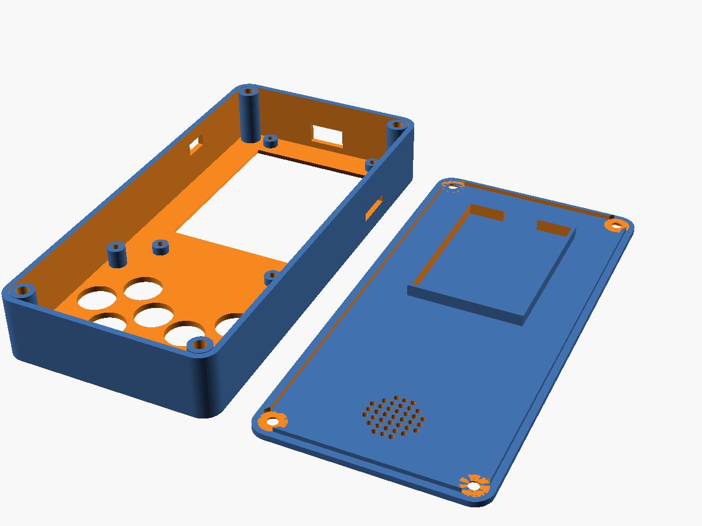

# Pocket Brick Console

A Brick-Game-style handheld: **ES3N28P** (ESP32-S3 + 2.8" screen + SD + audio + charger on one
board), 8 buttons through a **PCF8574**, a LiPo battery, and a **3D-printed case**.

Firmware: my own **Brick Game** in C++ (Tetris, Snake, Racing) first, then **Retro-Go**
(NES / GB / GBC / SMS / GG emulators).



## Documents

| File | Contents |
|---|---|
| [HANDOFF.md](HANDOFF.md) | **Current status and next steps. Read first in a new session.** |
| [SHOPPING.md](SHOPPING.md) | What to order, tools, software |
| [PLAN.md](PLAN.md) | Roadmap and milestone checklists (start here) |
| [HARDWARE.md](HARDWARE.md) | Board pin map, button wiring, mechanical data |
| [ENCLOSURE.md](ENCLOSURE.md) | 3D-printed case: layout, what to measure, printing, assembly |

## Folders

```
game-console/
├── enclosure/
│   ├── case.scad          parametric case (OpenSCAD)
│   ├── stl/               shell.stl, lid.stl, test_front.stl (draft v1)
│   └── preview/           rendered images
├── firmware/
│   ├── retro-go-gmt024-s3/   Retro-Go fork (base for the es3n28p target)
│   └── prebuilt/             image for the OLD gmt024 hardware – does NOT run on ES3N28P
└── docs/
    ├── es3n28p/           board drawing, schematic, spec, STEP 3D model
    └── archive-brass/     the earlier brass-frame plan (for reference)
```
